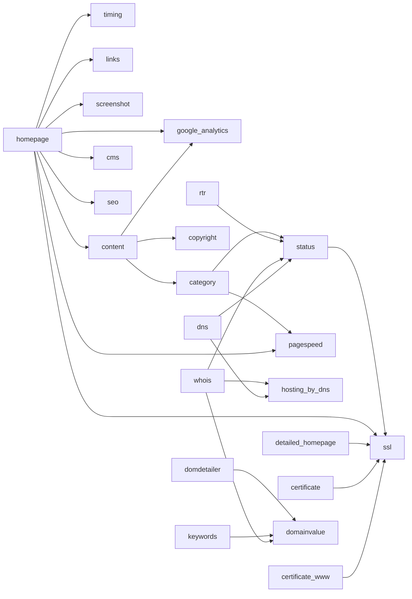

# Domain connectors

This page describes every connector of the item type `hosting/domain`: the 36 files in `sitekick/hosting/domain/` and
the overrides in `argeweb/hosting/domain/`. The key of a domain item is its domain name; a connector reads it as
`params.domain`. For the keywords used below, see the [YAML reference](../language/yaml-reference.md); for the storage
tiers (indexed fields, JSON, files), see [Storage](../storage.md).

Each connector is described with:

| Entry | Meaning |
|---|---|
| Data form | The `type` of the connector, which sets the available storage columns |
| Refresh | The refresh rule; "default" is the platform's default interval (see [Refresh rules](../language/refresh.md)) |
| Includes | Connectors of the same domain that are fetched first (see [Includes and requirements](../language/includes-and-requires.md)) |
| Requires | The condition that must hold, with the status stored when it does not |
| Functions | The platform functions called, by dotted name |
| External service | The outside service that provides the data |
| Stores | Indexed fields, JSON and files |

## Overview

| Group | Connectors |
|---|---|
| Item type | [`_entity`](#_entity) |
| Reachability, redirects and HTTPS | [`homepage`](#homepage), [`detailed_homepage`](#detailed_homepage), [`timing`](#timing), [`links`](#links), [`screenshot`](#screenshot) |
| Certificates and SSL | [`certificate`](#certificate), [`certificate_www`](#certificate_www), [`ssl`](#ssl) |
| Lighthouse and PageSpeed | [`pagespeed`](#pagespeed) |
| Content and technology | [`content`](#content), [`category`](#category), [`status`](#status), [`cms`](#cms), [`copyright`](#copyright), [`google_analytics`](#google_analytics), [`seo`](#seo) |
| DNS, domain and hosting | [`dns`](#dns), [`whois`](#whois), [`hosting_by_dns`](#hosting_by_dns), [`internet_nl`](#internet_nl), [`rtr`](#rtr), [`availability`](#availability), [`domdetailer`](#domdetailer), [`keywords`](#keywords), [`domainvalue`](#domainvalue), [`plesk`](#plesk), [`subscription`](#subscription) |
| Pseudo-connectors | [`multi`](#multi), [`hubspot`](#hubspot) |
| Test connectors | [`sleep`](#sleep), [`test`, `test3`](#test-and-test3), [`test-req-1`, `test-req-2`, `test-req-3`](#test-req-1-test-req-2-and-test-req-3) |
| `argeweb` | [item type](#argeweb-domain-item-type), [`crm`](#crm) |



The diagram shows which connector includes which: an arrow points from the included connector to the connector that
includes it.

## Item type

### _entity

`sitekick/hosting/domain/_entity.yaml` defines the item type domain.

| Entry | Value |
|---|---|
| Key names | `domain` |
| Attributes | Data form `JsonStrInt`; refresh `never` |
| Functions | `functions.hosting.get_tld`, `functions.hosting.get_sld` |
| Relations | A domain has at most one hosting platform; a platform has any number of domains. A domain has at most one server, under the relation name `server`; a server has any number of domains, under the name `domains` |

| Indexed field | Type | Meaning |
|---|---|---|
| `tld` | str | The top-level domain of the key, from the public suffix list, for example `com` or `co.uk` |
| `sld` | str | The registrable domain of the key, for example `example.com` |

## Reachability, redirects and HTTPS

### homepage

Resolves the domain the way a browser does. It tries `https://`, `https://www.`, `http://` and `http://www.`, in that
order, follows redirects and meta refreshes, and keeps the first address that responds.

| Entry | Value |
|---|---|
| Data form | `StrInt` |
| Refresh | default |
| Requires | `data.final_url` (404) |
| Functions | `functions.hosting.homepage` |
| Stores | Indexed fields |

| Indexed field | Type | Meaning |
|---|---|---|
| `url` | str | The first address that responds, for example `https://example.com` |
| `final_url` | str | The address after all redirects, for example `https://www.example.com/` |
| `final_domain` | str | The domain of the final address, for example `example.com` |
| `https` | int | 1 when the final address uses https, else 0 |
| `http_redirected` | int | The number of redirects followed to reach the final address, including meta refreshes |
| `redirects` | int | The HTTP status code of the first redirect, for example `301` |
| `domain_redirected` | int | 1 when the final domain differs from the domain itself, else 0 |

### detailed_homepage

Requests all four combinations of `http`/`https` with and without `www.` and compares the results, to show how https
and `www.` are set up.

| Entry | Value |
|---|---|
| Data form | `JsonStrInt` |
| Refresh | default |
| Requires | `data.final_url` (404) |
| Functions | `functions.hosting.detailed_homepage` |
| Stores | Indexed fields; the complete result as JSON |

| Indexed field | Type | Meaning |
|---|---|---|
| `final_url` | str | The final address of the first combination that responds (order `https`, `https-www`, `http`, `http-www`) |
| `https` | int | 1 when the website supports https, else 0 |
| `http_redirected` | int | 1 when a request over http is redirected to https, else 0 |
| `www_supported` | int | 1 when the `www.` address works, else 0 |
| `redirected_to_www` | int | 1 when all addresses end at the `www.` address, else 0 |

The JSON holds the complete result: `final_url`, `https_supported`, `http_redirected`, `www_supported`,
`redirected_to_www`, `endpoints_are_identical` (all four combinations end at the same address), and `all_urls` with the
final address per combination (`https`, `https-www`, `http`, `http-www`) and, when requests failed, `errors` and `error`.

### timing

Measures the response times of the homepage. After one warm-up request, the homepage is requested ten times; the stored
values are the averages.

| Entry | Value |
|---|---|
| Data form | `FloatInt` |
| Refresh | `every: ~month` |
| Includes | `homepage` |
| Requires | `include.homepage.attributes.final_url` (404) |
| Functions | `functions.hosting.website_response_times` |
| Stores | Indexed fields |

| Indexed field | Type | Meaning |
|---|---|---|
| `ttfb` | float | Time to first byte, in seconds, for example `0.0875` |
| `ttfb_ex_dns` | float | Time to first byte without the DNS lookup, in seconds |
| `connection_time` | float | Time until the connection is set up, in seconds |
| `ttlb` | float | Time to last byte, in seconds; this is not the time to first render |
| `content_size` | int | Size of the homepage in kB, at most 32767 |
| `speed` | int | Download speed in MB/s, at most 32767 |

### links

Checks the links of the website: the links on the homepage and on the pages it links to, up to three levels deep,
including external links.

| Entry | Value |
|---|---|
| Data form | `StrInt` |
| Refresh | default |
| Includes | `homepage` |
| Requires | `include.homepage.attributes.final_url` (424) |
| Functions | `functions.hosting.link_check` |
| External service | LinkChecker |
| Stores | Indexed fields; file `full.json` with the result per checked link |

| Indexed field | Type | Meaning |
|---|---|---|
| `valid` | int | Number of valid links |
| `invalid` | int | Number of invalid (broken) links |

### screenshot

Full-page screenshots of the homepage, without cookie banners, advertisements and tracking, for desktop and mobile.

| Entry | Value |
|---|---|
| Data form | `Empty` |
| Refresh | default |
| Includes | `homepage` |
| Requires | `include.homepage.attributes.final_url` (424) |
| Functions | `get` (HTTP); `functions.images.convert.crop` and `functions.images.convert.save_as`, imported in a `code` block |
| External service | ApiFlash |
| Stores | Files only |

| File | Content |
|---|---|
| `desktop.webp` | Full, scrollable page, 1920 pixels wide, desktop browser |
| `mobile.webp` | Full, scrollable page, 384 pixels wide, mobile browser |
| `desktop-thumb.webp` | The top 1920 × 1440 pixels of the desktop image, scaled to 768 × 576 |
| `mobile-thumb.webp` | The top 384 × 768 pixels of the mobile image |

All images are WebP with quality 95.

## Certificates and SSL

### certificate

The TLS certificate that the domain presents on port 443, when there is one.

| Entry | Value |
|---|---|
| Data form | `StrDateInt` |
| Refresh | default |
| Requires | `data.commonName` (404) |
| Functions | `functions.hosting.analyze_certificate` |
| Stores | Indexed fields |

| Indexed field | Type | Meaning |
|---|---|---|
| `issuer` | str | The issuer of the certificate, for example `R11` or `Sectigo RSA Extended Validation Secure Server CA` |
| `invalid` | str | Why the certificate is not valid for the host: it is issued for other host names, or it is not valid at this moment; empty when valid |
| `common_name` | str | The name the certificate is issued for, for example `*.example.com` |
| `valid_from` | datetime | Start of the validity period, for example `2026-04-22T00:00:00` |
| `valid_to` | datetime | End of the validity period |

### certificate_www

Identical to [certificate](#certificate), for the host name `www.` plus the domain.

### ssl

A combined view of https and the certificate, built from five other connectors. It is the basis of the SSL advice.

| Entry | Value |
|---|---|
| Data form | `StrInt` |
| Refresh | default |
| Includes | `status`, `homepage`, `detailed_homepage`, `certificate`, `certificate_www` |
| Stores | Indexed fields |

| Indexed field | Type | Meaning |
|---|---|---|
| `category` | str | The category from [status](#status) |
| `final_url` | str | The final address, from [homepage](#homepage) |
| `https` | int | 1 when the website supports https, from [detailed_homepage](#detailed_homepage) |
| `http_redirected` | int | 1 when http is redirected to https, from [detailed_homepage](#detailed_homepage) |
| `www_consistent` | int | 1 when the addresses with and without `www.` end at the same website |
| `domain_redirected` | int | 1 when the domain redirects to another domain, from [homepage](#homepage) |
| `issuer` | str | The issuer of the certificate of the domain |
| `invalid` | str | Why the certificate of the domain, or else that of its `www.` host name, is not valid |

## Lighthouse and PageSpeed

### pagespeed

Runs Google PageSpeed Insights (Lighthouse) on the final address of the homepage for the categories Performance,
Accessibility, Best Practices and SEO, with locale `nl-NL` and the default (desktop) strategy. It runs only for websites
whose category is `active`.

| Entry | Value |
|---|---|
| Data form | `FloatInt` |
| Refresh | default |
| Includes | `homepage`, `category` |
| Requires | `include.homepage.attributes.final_url and include.category.attributes.category == 'active'` (424) |
| Functions | `get` (HTTP); the helper `lighthouse_summary` is defined in a `code` block |
| External service | Google PageSpeed Insights (API key stored encrypted) |
| Stores | Indexed fields; files `report.json` and `summary.json` |

| Indexed field | Type | Meaning |
|---|---|---|
| `performance` | int | Performance score, 0 to 100 |
| `accessibility` | int | Accessibility score, 0 to 100 |
| `best-practices` | int | Best practices score, 0 to 100 |
| `seo` | int | SEO score, 0 to 100 |

| File | Content |
|---|---|
| `report.json` | The complete Lighthouse report as returned by the service |
| `summary.json` | Per audit the `score`, `displayValue`, `numericValue` and `numericUnit`; per category the score and the audit references with a weight; the category groups |

## Content and technology

### content

Downloads the homepage and analyses its text. The result is only stored as a file, per domain; it is not available in
lists. It is the source for [category](#category), [copyright](#copyright) and [google_analytics](#google_analytics).

| Entry | Value |
|---|---|
| Data form | `Empty` |
| Refresh | default |
| Includes | `homepage` |
| Requires | `include.homepage.attributes.final_url` (424) |
| Functions | `functions.hosting.content` |
| Stores | File `full.json` |

`full.json` contains:

| Key | Content |
|---|---|
| `html` | The HTML of the homepage |
| `markdown` | The content as Markdown, including links and images |
| `text`, `text_ascii` | The text only, as Unicode and as plain ASCII |
| `wordcount`, `words` | The count per word, and the sorted list of unique words |
| `language` | The language detected from the words |
| `word_frequencies` | Per word its relative frequency compared with a corpus of the language |
| `domain_name`, `titles`, `descriptions` | The same analysis for the words of the domain name, the title and headings, and the meta descriptions |
| `stopwords` | The stop words found |
| `language_html` | The language in the `lang` attribute of the HTML |

### category

Determines the category of the website from the content of its homepage. The category shows how far the owner has
come in setting up the website.

| Entry | Value |
|---|---|
| Data form | `StrInt` |
| Refresh | default |
| Includes | `content` (its `full.json` is read) |
| Functions | `functions.hosting.category_by_content` |
| External service | Google Web Risk |
| Stores | Indexed fields |

| Indexed field | Type | Meaning |
|---|---|---|
| `category` | str | The category, see below |
| `subcategory` | str | A refinement of the category, see below |
| `arguments` | str | Extra detail, such as the provider whose page was recognised (for example `Sedo`, `TransIP` or `DirectAdmin`) or an error message |

The function decides in this order:

1. When the homepage cannot be resolved, the category is `error`, with the kind of error in `subcategory` and the
   message in `arguments`, or `unreachable` when there is no error message.
2. When Google Web Risk lists the address, the category is `abuse`, with subcategory `Google Safe Browsing` and the
   threat types in `arguments`.
3. When no content is available, the category is `no_content`.
4. The keyword sets in `category_keywords` are compared with the content, in the order of the file; the first set that
   matches gives the category, subcategory and arguments. A set of plain words matches when (almost) all its words are
   among the ten most characteristic words of the page; a set containing spaces or patterns matches when every pattern
   is found in the text or the headings.
5. When no set matches, the category is `active`.

| Category | Meaning |
|---|---|
| `active` | A website with its own content |
| `initiated` | Building a website was started but abandoned, for example a default page of a web server or control panel |
| `installed` | A CMS is installed without own content, for example a new WordPress site with only its default sample post |
| `parked` | A standard landing page of a registrar or hosting provider; there is no website |
| `outdated` | Active, but built with outdated technology, such as FrontPage frames |
| `forsale` | The domain is offered for sale, for example through a domain broker |
| `unreachable` | The server does not respond, or shows a page that blocks access |
| `abuse` | The address is listed by Google Web Risk |
| `no_content` | The homepage responds, but no content could be retrieved |
| `error` | The homepage cannot be resolved because of an error |

| Subcategory | Category | Meaning |
|---|---|---|
| `Hello world` | `initiated` | A default "hello world" page |
| `Lorem ipsum` | `initiated` | A page with placeholder text |
| `Google pages` | `initiated` | A "requested URL was not found" page |
| `Moved out` | `parked` | The landing page of another provider: the domain has moved |
| `DDoS protection` | `unreachable` | A DDoS protection page is shown instead of the website |
| `pending validation` | `unreachable` | The registration is waiting for validation |
| `account suspended` | `unreachable` | The hosting account is suspended |
| `Google Safe Browsing` | `abuse` | The source of the listing |

To add a recognised page, add a keyword set to `category_keywords` with its `category`, `keywords` and optionally
`subcategory` and `arguments`.

### status

The overall status of the domain: registration, whois, DNS and website category in one value, together with the
subscription of the domain.

| Entry | Value |
|---|---|
| Data form | `StrInt` |
| Refresh | `every: ~month`, or `6 ~months` when the category is `active` |
| Includes | `category`, `rtr`, `whois`, `dns` |
| Functions | `functions.hosting.supercat` |
| Stores | Indexed fields |

| Indexed field | Type | Meaning |
|---|---|---|
| `category` | str | The overall category, see below |
| `subcategory` | str | The subcategory from [category](#category) |
| `subscription` | str | The category of the domain's subscription, from the item's attribute `subscription` (for example `web` or `mail`) |
| `slugs` | str | The product slugs of the domain's subscriptions, from the same attribute |

The checks are made in this order; the first that applies sets the category. When none applies, the category of
[category](#category) is used.

| Category | Meaning |
|---|---|
| `no_supported_tld` | The TLD is not supported by the registry check |
| `not_registered` | The domain is not registered and is available for registration |
| `no_whois` | The domain is registered, but no whois data is available |
| `no_dns` | The domain is registered, but no DNS data is available |
| `no_nameserver` | There is DNS data, but no name server |
| `no_a_record` | There is DNS data, but no A record, so no website |
| `no_your_online_webserver` | The name servers do not belong to one of the brands of the your.online group |
| `no_valid_website` | All checks pass, but no website category is available |

A category that starts with `no_` means that the website is not available, or is not hosted by one of the brands.

### cms

The content management system of the website, its version and whether that version is secure.

| Entry | Value |
|---|---|
| Data form | `JsonStrInt` |
| Refresh | default |
| Includes | `homepage` |
| Requires | `include.homepage.attributes.final_url` (424) |
| Functions | `functions.hosting.get_cms` |
| External service | WhatCMS |
| Stores | Indexed field; the complete result as JSON |

| Indexed field | Type | Meaning |
|---|---|---|
| `cms` | str | The detected CMS |

| JSON field | Meaning |
|---|---|
| `name` | Common name of the CMS, for example `WordPress` |
| `type` | The type of CMS, when several applications are detected |
| `version` | The detected version, for example `6.8.1` |
| `status` | For WordPress: `latest`, `outdated` or `insecure`, or `unknown` |
| `requiredVersion` | For WordPress: the version to upgrade to at least, to be secure |
| `recommendedVersion` | For WordPress: the latest version |
| `confidence` | The confidence of the detection, 0 to 100 |
| `score`, `ok` | The score of the check (1 when no issue is found, lower for an outdated or insecure version) and whether it passes |
| `title`, `description` | A title and an advice for the user, in Dutch |

### copyright

The most recent copyright year on the homepage, as an indication of how up to date the website is. A notice such as
`© 2013-2025` gives `2025`. Up to three words between the copyright sign and the year are skipped, two-digit years are
expanded, and only years from 1980 up to the current year are accepted.

| Entry | Value |
|---|---|
| Data form | `StrInt` |
| Refresh | default |
| Includes | `content` (its `full.json` is read) |
| Requires | `content_file` (424); `match`, a copyright notice is found (404); `requires1`, the year is between 1980 and now (404) |
| Stores | Indexed field |

| Indexed field | Type | Meaning |
|---|---|---|
| `year` | int | The most recent copyright year, for example `2025` |

### google_analytics

Detects Google Analytics and Google Tag Manager in the HTML of the homepage.

| Entry | Value |
|---|---|
| Data form | `StrInt` |
| Refresh | default |
| Includes | `homepage`, `content` (its `full.json` is read) |
| Requires | `include.homepage.attributes.final_url` (424) |
| Functions | `functions.hosting.google_analytics` |
| Stores | Indexed fields |

| Indexed field | Type | Meaning |
|---|---|---|
| `has_analytics` | int | 1 when analytics is found |
| `type` | str | `Google Analytics 4`, `Universal Analytics`, `Google Tag Manager`, `Google Analytics (gtag)` or `Google Analytics (analytics.js)` |
| `tracking_id` | str | The measurement or container id, for example `G-XXXXXXXXXX` or `GTM-XXXXXXX` |

### seo

Designed for an SEO analysis of the homepage with the open-source tool python-seo-analyzer, with a summary as JSON and
the full analysis as a file.

| Entry | Value |
|---|---|
| Data form | `Json` |
| Refresh | default |
| Includes | `homepage` |

## DNS, domain and hosting

### dns

Looks up the DNS records of the domain and derives the hosting information from them.

| Entry | Value |
|---|---|
| Data form | `StrInt` |
| Refresh | `every: "3 ~months" if not index.a1 else "1 ~month"`: monthly, or every three months when there is no A record |
| Parameters | `dns_type`, default `common` |
| Requires | `dns` (404) |
| Functions | `functions.hosting.nslookup` |
| Stores | Indexed fields; file `full.json` with the full lookup |

The parameter `dns_type` selects the record types: `common` is A, AAAA, NS, MX and TXT; `complete` adds SOA, CNAME,
SRV and CAA; any other value is read as a list of record types. The key `substitutions` maps regular expressions to
generic names, so that numbered name servers are recognised as one provider, for example `awsdns-12` as `awsdns`.

| Indexed field | Type | Meaning |
|---|---|---|
| `a1` | str | The first A record, the IP address of the web server |
| `a_fqdn1` | str | The host name of that address, which often identifies the hosting provider or the server |
| `ns1` | str | The first name server |
| `mx1` | str | The first mail server |

`full.json` contains the records per type (`a`, `aaaa`, `ns`, `mx`, `txt`, ...), the host names of the addresses
(`a_fqdn`, `aaaa_fqdn`), and a section `generic` with the first values and their generic names, such as `ns1_short`,
`mx1_short` and `a_fqdn1_short`. To make one of these fields available for filtering, add it to the `index` section.

### whois

The whois registration data of the domain. The content depends on the registry, from almost nothing for `.de` to
extensive for `.com`; the data is converted to a common format as far as possible.

| Entry | Value |
|---|---|
| Data form | `StrDateInt` |
| Refresh | default |
| Functions | `functions.hosting.whois` |
| External service | The whois services of the registries; WhoisXML API for some TLDs |
| Stores | Indexed fields; file `full.json` with the full whois data |

| Indexed field | Type | Meaning |
|---|---|---|
| `registrar` | str | Name of the registrar |
| `name_server` | str | Generic name of the first name server, such as `cloudflare` |
| `name_servers` | str | Comma-separated name servers as given by whois |
| `creation_date` | datetime | Registration date of the domain |
| `expiration_date` | datetime | Expiration date of the registration |

The fields are read with `@suppress`, so a field that the registry does not provide stays empty.

### hosting_by_dns

Compares the registration in whois with the actual DNS set-up.

| Entry | Value |
|---|---|
| Data form | `StrInt` |
| Refresh | default |
| Includes | `whois`, `dns` |
| Stores | Indexed fields |

| Indexed field | Type | Meaning |
|---|---|---|
| `registrar` | str | The registrar, from whois |
| `ns_whois` | str | Comma-separated name servers according to whois |
| `status_whois` | int | 1 when the whois status of the domain is `active`, else 0 |
| `ns_dns` | str | Comma-separated name servers according to DNS |
| `a_fqdn` | str | Comma-separated host names of the web server addresses |

### internet_nl

The results of the internet.nl test for modern internet standards. The connector sends a message to a queue; a worker
runs the test and writes the scores back to this data point.

| Entry | Value |
|---|---|
| Data form | `FloatInt` |
| Refresh | `every: ~month` |
| Functions | `functions.queue.send` |
| External service | internet.nl |
| Stores | Indexed fields |

| Indexed field | Type | Meaning |
|---|---|---|
| `ipv6` | float | IPv6 support of the name servers and the web server, 0 to 10 |
| `dnssec` | float | DNSSEC, 0 to 10 |
| `https` | float | The https configuration: http, TLS connection and certificate, 0 to 10 |
| `total` | int | Total score, 0 to 100 |

The fields have no expression in the definition (`ipv6: -> float`), because their values are written by the worker.

### rtr

A real-time check at the registry whether the domain is available for registration.

| Entry | Value |
|---|---|
| Data form | `StrInt` |
| Refresh | default |
| Functions | `get` (HTTP) |
| External service | Realtime Register (API key stored encrypted) |
| Stores | Indexed fields |

| Indexed field | Type | Meaning |
|---|---|---|
| `available` | int | 1 when the domain is available for registration, else 0 |
| `premium` | int | 1 when the domain is a premium domain, else 0 |
| `message` | str | The message when availability is unknown, for example `The TLD "example" is not supported` |
| `type` | str | The type of that message, for example `UnsupportedTld` |

### availability

The availability of the domain name under other TLDs.

| Entry | Value |
|---|---|
| Data form | `Json` |
| Refresh | `on-demand`: evaluated on every request |
| Parameters | `tlds`, separated by spaces or commas; default `eu com be de me net nu org online` |
| Functions | `functions.hosting.available_tlds` |
| External service | Realtime Register |
| Stores | JSON |

| JSON field | Meaning |
|---|---|
| `availability` | A list of pairs of domain and availability, for example `["example.org", false]` |

Results are cached for a short time to respect the rate limits of the registry service.

```http
GET https://api.example.com/yourhosting/hosting/domain/example.com/availability?tlds=nl%20eu%20org
```

### domdetailer

Backlink and popularity metrics of the domain.

| Entry | Value |
|---|---|
| Data form | `FloatInt` |
| Refresh | default |
| Functions | `get` (HTTP), `functions.convert.convert_type` |
| External service | DomDetailer (API key stored encrypted) |
| Stores | Indexed fields; file `full.json` with the full result |

| Indexed field | Type | Meaning |
|---|---|---|
| `majesticCF` | int | Majestic Citation Flow, 0 to 100 |
| `majesticTF` | int | Majestic Trust Flow, 0 to 100 |
| `majesticLinks` | float | Number of external links to the domain, according to Majestic |
| `majesticRefDomains` | float | Number of referring domains |
| `majesticRefSubnets` | int | Number of referring subnets |
| `majesticIPs` | float | Number of referring IP addresses |
| `mozLinks` | int | Number of links to the domain, according to Moz |
| `mozRank` | float | Moz popularity score, 0.1 to 10 on a logarithmic scale |

### keywords

Search volume, cost per click, competition and trend for keywords. Without parameters, the keywords are derived from
the domain name, split into words.

| Entry | Value |
|---|---|
| Data form | `Empty` |
| Refresh | default |
| Parameters | `keyword`: one keyword; `keywords`: several keywords, separated by commas or spaces |
| Functions | `functions.hosting.make_keywords`, `functions.convert.convert_type`, `f.http.request.post`; the helper `convert_month` is defined in a `code` block |
| External service | Keywords Everywhere (API key stored encrypted) |
| Stores | File `full.json` |

`full.json` holds one entry per keyword with `keyword`, `vol` (monthly search volume), `cpc` (cost per click, in
euros), `competition` and `trend` (search volume per month over the last twelve months, with months as numbers).

### domainvalue

An estimate of the financial value of the domain name. It combines the TLD, the length and composition of the name,
the search volume and cost per click of its keywords, the age of the registration and the backlink metrics.

| Entry | Value |
|---|---|
| Data form | `FloatInt` |
| Refresh | default |
| Includes | `domdetailer`, `keywords` (its `full.json` is read), `whois` |
| Functions | `functions.hosting.domain_value` |
| Stores | Indexed fields |
| Default modifier | `bff: extra`: by default the data point is returned with extra details, such as the TLD, whether the name has a digit or a hyphen, and the age of the domain |

| Indexed field | Type | Meaning |
|---|---|---|
| `value` | float | The estimated value in euros |
| `value_rounded` | float | The value rounded to two significant digits, the realistic estimate |
| `searchvol` | float | The search volume of the words of the domain name |
| `cpc` | float | The cost per click of the words of the domain name |
| `mozRank` | int | The mozRank from [domdetailer](#domdetailer), multiplied by 10 |

### plesk

Hosting data of the domain from the Plesk server that hosts it. The data is filled when the Plesk server pushes its
data to the platform; it is not refreshed by the schedule.

| Entry | Value |
|---|---|
| Data form | `Json` |
| Refresh | `never` |
| Functions | `functions.hosting.server.plesk.parse_plesk_output` |
| Stores | JSON; file `plesk.json` with all parsed data |

| JSON field | Meaning |
|---|---|
| `php_version` | The PHP version of the website |
| `Server` | Identifying data of the server, such as host name and IP address |
| `mail_accounts` | The mailboxes of the domain |
| `provider`, `provider-version` | The source of the data and the version of the collecting script |
| `plesk-version` | The Plesk version of the server |
| `plugins`, `themes` | The installed WordPress plugins and themes, with their versions |
| `wp_version`, `wp_state`, `wp_latest_version` | The installed WordPress version, its state and the latest available version |

To add more fields from `plesk.json` to the data point, extend the `json` section.

### subscription

Links a subscription that has been pushed for the domain to the domain. The function reads the pushed subscription,
creates or updates the subscription item (see [Subscriptions](other.md#subscriptions)), relates it to the domain, and
sets the `brand` attribute of the domain, with `yourhosting` as the default brand.

| Entry | Value |
|---|---|
| Data form | `Json` |
| Refresh | `never` |
| Functions | `functions.hosting.update_subscription` |
| Stores | JSON: the key of the subscription item |

The section `item.meta.created_at` is designed to set the creation date of the item to the start date of the
subscription.

## Pseudo-connectors

### multi

Requests several connectors of the same domain in parallel and returns their results in one object, keyed by the
requested path. The connector names follow `multi/` in the URL, separated by commas, and may carry a modifier:

```http
GET https://api.example.com/yourhosting/hosting/domain/example.com/multi/dns,whois,pagespeed/public
```

| Entry | Value |
|---|---|
| Data form | `Empty` |
| Refresh | `on-demand` |
| Stores | Nothing |

### hubspot

Requests a connector within a time limit, for callers that cannot wait long, such as HubSpot. The connector name
follows `hubspot/` in the URL. When the connector does not answer within `timeout` seconds, the request is answered
with the status in `status`.

```http
GET https://api.example.com/yourhosting/hosting/domain/example.com/hubspot/pagespeed
```

| Entry | Value |
|---|---|
| Data form | `Empty` |
| Refresh | `on-demand` |
| Parameters | `timeout`: 8 (seconds); `status`: 503 |
| Stores | Nothing |

## Test connectors

These connectors test the connector engine. They do not collect data about a domain.

### sleep

Waits for `seconds` seconds (default 10) and stores nothing. It is used to test time-outs and parallel requests.

| Entry | Value |
|---|---|
| Data form | `Empty` |
| Refresh | `on-demand` |
| Parameters | `seconds`, default `10` |

### test and test3

Exercise the expression evaluator: HTTP requests to a public echo service, conversion to and from JSON, arithmetic,
interpolated strings and nested values. The results are stored as JSON.

| Entry | Value |
|---|---|
| Data form | `JsonStrInt` |
| Refresh | default |

### test-req-1, test-req-2 and test-req-3

Exercise includes and requirements.

| Connector | Includes | Requires | Indexed fields |
|---|---|---|---|
| `test-req-1` | — | `int(params.requires)`; the parameter `requires` defaults to `1`, so `?requires=0` makes the requirement fail (404) | `now` (datetime), `timestamp` (str): the moment of evaluation |
| `test-req-2` | `test-req-1` | `include['test-req-1'].attributes.now` (424) | `now`, `timestamp`, copied from `test-req-1` |
| `test-req-3` | `test-req-1`, `test-req-2`, in parallel | `now` of one of them (424) | `now`, `timestamp`, from the first that has them |

All three use the data form `StrDateInt` and the default refresh. Include names with a hyphen are read as
`include['test-req-1']`.

## argeweb

The client `argeweb` inherits all connectors above and has its own domain item type.

### argeweb domain item type

`argeweb/hosting/domain/_entity.yaml` defines the domain item type for `argeweb`, with the key name `domain` and the
indexed attributes `tld` and `sld`, calculated as for [`sitekick`](#_entity). It declares no relations.

| Entry | Value |
|---|---|
| Attributes | Data form `JsonStrInt`; refresh `never` |
| Functions | `functions.hosting.get_tld`, `functions.hosting.get_sld` |

### crm

Legacy. Designed for customer and domain data of the domain from the Argeweb customer administration, from an earlier version of
the platform.

| Entry | Value |
|---|---|
| Data form | `JsonStrInt` |
| Refresh | default |
| Stores | JSON: `customer` and `domain` |
