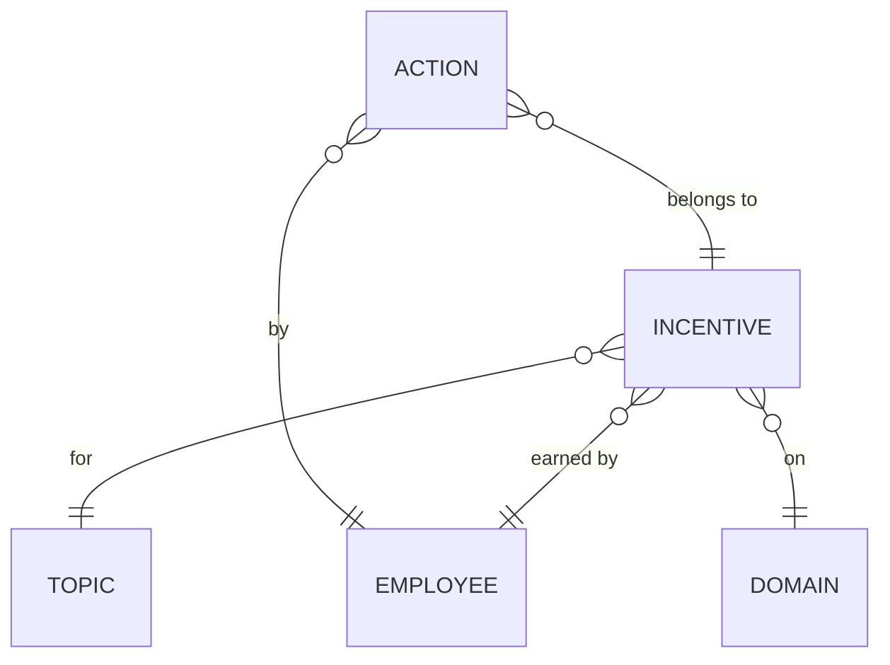

# Other connectors

This page describes all connectors and item types outside `hosting/domain`: servers, networks and platforms, settings,
the incentive programme, subscriptions, products and customers of `your.online`, the legacy `parker` item types, and
the development and test connectors. The domain connectors are on [Domain connectors](hosting-domain.md); the full
list is in the [catalogue](index.md).

Many folders contain only an `_entity.yaml`. Such an item type has no connectors of its own; its attributes are set
through the API and are returned with the item (see [Entities and relations](../entities-and-relations.md)).

## Servers

Folder `sitekick/hosting/server`. A server is identified by its IP address.

### _entity

| Entry | Value |
|---|---|
| Key names | `ip`, `address`, `ip-address`, `ip_address`, `ipaddress` |
| Attributes | Data form `JsonStrInt`; refresh `never`; set through the API |
| Relations | A server is hosted on at most one platform, under the relation name `hosted-on`; a platform hosts any number of servers, under the name `hosts`. The relation to domains is declared by the [domain item type](hosting-domain.md#_entity) |

| Indexed field | Type | Meaning |
|---|---|---|
| `name` | str | Name of the server |
| `brand` | str | The brand the server belongs to |
| `cpus` | int | Number of CPUs |
| `mem` | int | Memory |
| `disks` | int | Number of disks |

### ipapi

Designed for network and location data for the IP address of the server, such as the network owner, the autonomous system and the
location, stored as JSON.

| Entry | Value |
|---|---|
| Data form | `JsonStrInt` |
| Refresh | default |
| Functions | `f.http.request.get` |
| External service | ipapi |
| Stores | JSON: the complete answer |

### info

Designed for general information about a server. The definition sets only its data form, `JsonStrInt`.

### plesk

Designed for Plesk data that a server pushes to the platform. The connector reads the pushed data by its key and
stores the host name, IP address and MAC address of the server.

| Entry | Value |
|---|---|
| Data form | `StrInt` |
| Refresh | `never` |
| Parameters | `key`: the key of the pushed data |
| Functions | `functions.data.get_pushed_data` |
| Properties | `min_refresh_time: 2592000` (30 days); `max_timestamps: 10` |
| Stores | Indexed fields |

| Indexed field | Type | Meaning |
|---|---|---|
| `hostname` | str | Host name of the server |
| `ip-address` | str | IP address of the server |
| `mac-address` | str | MAC address of the server |

### server

Designed for server information that a server pushes as text: the output of `uptime`, `free` and `lscpu`. A `code`
block parses it into the uptime in days, the number of users and the load averages, the memory figures and the CPU
properties, and stores them as JSON.

| Entry | Value |
|---|---|
| Data form | `JsonStrInt` |
| Refresh | default |

## Networks and platforms

| File | Content |
|---|---|
| `sitekick/hosting/network/_entity.yaml` | Item type network. The file is empty: the item type has no key names, attributes or relations of its own |
| `sitekick/hosting/platform/_entity.yaml` | Item type hosting platform. Its relations are declared by the other side: domains and servers each have at most one platform |

## Global settings

Folder `sitekick/global/setting`. Item type for global settings of a brand, stored as items with free JSON
attributes. The platform uses it, for example, for the item `sync`, whose attributes hold the moment of the last
domain synchronisation.

| Entry | Value |
|---|---|
| Attributes | Data form `Json`; refresh `never` |

```http
GET https://api.example.com/yourhosting/global/setting/sync/attributes
```

## Public item types

Folders `sitekick/public/get` and `sitekick/public/put`. Each defines an item type in the group `public`, with free
JSON attributes that are never refreshed.

| Entry | Value |
|---|---|
| Attributes | Data form `Json`; refresh `never` |

## Incentive programme

Folders `your.online/commercial/*` and `your.online/contact/email`. For an incentive programme, the platform checks
whether an action of an employee, such as advising a customer, has had the desired effect on a domain, and then gives
the employee the points for that incentive. `your.online` is the parent client of `yourhosting`, so in the API you use
the brand, for example `/yourhosting/commercial/incentives`.



An action is posted to `/{brand}/commercial/actions`. The platform then creates or finds the employee, the domain, the
topic and the incentive, relates them, and requests the incentive's topic connector. The incentive is the combination
of employee, domain and topic.

### Item types

| File | Item type | Content |
|---|---|---|
| `commercial/action/_entity.yaml` | action | One action of an employee. Its key combines e-mail address, domain, topic, action and timestamp. Attributes `JsonStrInt`, refresh `never`. An action belongs to exactly one incentive and one employee; an incentive has one or more actions |
| `commercial/incentive/_entity.yaml` | incentive | The combination of employee, domain and topic. Attributes `JsonStrInt`, refresh `never`; the indexed fields below are set when the incentive is created, and the topic connector sets the attribute `points`. An incentive has exactly one topic, one employee and one domain |
| `commercial/topic/_entity.yaml` | topic | A topic of the programme, such as `ssl` or `m365`. Attributes `StrInt` with the indexed field `topic`, refresh `never` |
| `commercial/report/_entity.yaml` | report | Reports on the incentives. Attributes `JsonStrInt`, refresh `every: night` (once a day, at night) |
| `contact/email/_entity.yaml` | employee | Identified by e-mail address; key names `user` and `email`. Attributes `StrInt` with the indexed fields `user_id` and `uuid` (str), refresh `never` |

Indexed fields of the incentive:

| Indexed field | Type | Meaning |
|---|---|---|
| `year`, `month`, `week`, `day` | int | The date of the action, for aggregation in reports |
| `action` | str | The action, for example `advise_sent` |
| `employee` | str | The e-mail address of the employee |
| `domain` | str | The domain |
| `topic` | str | The topic |

### aggregate

`commercial/action/aggregate.yaml`. Designed for counting the unique actions of the related actions, stored as JSON.

| Entry | Value |
|---|---|
| Data form | `JsonStrInt` |
| Refresh | default |

### Topic connectors

Every file in `commercial/incentive/` other than `_entity.yaml` is a topic. A topic connector reads the domain of the
incentive from `self.attributes.domain`, decides in the field `valid` whether the desired state has been reached, and
sets the points of the incentive in a key `set-incentive`, with `functions.yourhosting.commercial.incentives.set_incentive_points`
(which patches the attribute `points`), unless stated otherwise below.

#### domain

Checks which of the TLDs `nl`, `be`, `eu`, `com`, `online`, `de`, `net`, `org`, `email` and `tel` have been
registered for the domain name since the incentive started.

| Entry | Value |
|---|---|
| Data form | `JsonStrInt` |
| Refresh | Designed to check daily during the first three months after the incentive was created |
| Functions | `functions.hosting.available_tlds`, `functions.yourhosting.commercial.incentives.registered_domains`, `functions.http.request.patch` (sets `points`) |
| External service | Realtime Register |
| Stores | JSON |

| JSON field | Meaning |
|---|---|
| `availability` | Pairs of domain and availability for the listed TLDs |
| `registered` | The domains whose registration status changed in the history of this data point |
| `valid` | True when at least one domain was registered |
| `count` | The number of such domains |

The name `domain` is the connector name; the key `domain` inside the definition holds the domain of the incentive.

#### m365

Checks whether the e-mail of the domain is handled by Microsoft 365: valid as soon as one MX record points to
`*.mail.protection.outlook.com`.

| Entry | Value |
|---|---|
| Data form | `StrInt` |
| Refresh | `every: "day" if not index.valid else "3 months"` |
| Functions | `functions.hosting.nslookup` (MX records) |
| Stores | Indexed fields |

| Indexed field | Type | Meaning |
|---|---|---|
| `mx` | str | Comma-separated MX records |
| `mx1` | str | The first MX record |
| `mx1_short` | str | Generic name of the first mail server |
| `valid` | int | 1 when an MX record points to Microsoft 365 |

#### ssl and ssl_https

Two topics with the same check: the domain has a valid certificate. Both also record whether the website uses https
and who issued the certificate.

| Entry | Value |
|---|---|
| Data form | `StrInt` |
| Refresh | `every: "day" if not index.valid else "3 months"` |
| Functions | `functions.hosting.homepage`, `functions.hosting.analyze_certificate` |
| Stores | Indexed fields |

| Indexed field | Type | Meaning |
|---|---|---|
| `issuer` | str | The issuer of the certificate |
| `valid_from`, `valid_to` | str | The validity period of the certificate, ISO 8601 |
| `invalid` | str | Why the certificate is not valid, empty when valid |
| `https` | int | 1 when the final address of the homepage uses https |
| `domain_redirected` | int | 1 when the domain redirects to another domain |
| `valid` | int | 1 when a certificate is present and valid |
| `paid_provider` | int | 1 when the issuer name is not of the form letters plus digits (such as `R11` or `E5` of Let's Encrypt), so the certificate is probably a paid one |

#### website

Checks whether the website of the domain is `active`. It uses the same keyword sets and function as the
[category](hosting-domain.md#category) connector.

| Entry | Value |
|---|---|
| Data form | `StrInt` |
| Refresh | `every: "day" if not index.valid else "3 months"` |
| Functions | `functions.hosting.category_by_content` |
| Stores | Indexed fields |

| Indexed field | Type | Meaning |
|---|---|---|
| `category`, `subcategory`, `arguments` | str | As in [category](hosting-domain.md#category) |
| `valid` | int | 1 when the category is `active` |

## CRM templates

Folder `your.online/crm/template`. Item type for CRM templates, with free JSON attributes (`JsonStrInt`); the
attributes are not refreshed on a schedule (`never`).

## Subscriptions

Folder `your.online/hosting/subscription`. A subscription of a customer for a product, identified by its UUID.
Subscriptions are pushed for a domain and linked to it by the domain connector
[subscription](hosting-domain.md#subscription).

### _entity

| Entry | Value |
|---|---|
| Key names | `uuid` |
| Relations | A subscription belongs to exactly one domain, under the relation name `domain`; a domain has any number of subscriptions, under the name `subscriptions` |

### attributes

The attributes of a subscription, set through the API. They are defined in a separate file, `attributes.yaml`, instead
of in an `attributes` section of `_entity.yaml`; both forms define the same `attributes` connector (see
[Entities and relations](../entities-and-relations.md#attributes-in-a-separate-file)).

| Entry | Value |
|---|---|
| Data form | `JsonStrInt` |
| Refresh | `never` |
| Stores | Indexed fields; all supplied data as JSON |

| Indexed field | Type | Meaning |
|---|---|---|
| `start_date` | str | Start of the subscription, ISO 8601 |
| `end_date` | str | End of the subscription |
| `cancel_date` | str | Date of cancellation |
| `product_slug` | str | The product, as a slug |
| `contract_period` | int | The contract period |
| `billing_period` | int | The billing period |

### retrieve

Designed for registering a pushed subscription on the subscription item type itself, instead of through a domain, as
a subscription does not always have a domain. It calls `functions.hosting.update_subscription` with the default brand
`yourhosting`, stores the result as JSON, and is never refreshed.

## Products

Folders `your.online/product/domain`, `product/email`, `product/hosting` and `product/subscription`. Each defines an
item type for one kind of product, with attributes of the data form `StrInt` that are not
refreshed on a schedule (`never`). They have no
connectors of their own.

## Sandwave customers

Folder `your.online/sandwave/customer`. Sandwave is the customer and subscription administration of yourhosting.nl;
this item type holds its customers.

### _entity

| Entry | Value |
|---|---|
| Relations | A customer has any number of subscriptions and any number of domains; a subscription and a domain each belong to at most one customer |

### attributes

The attributes of a customer, set through the API and defined in `attributes.yaml`, with the same fields as the
[subscription attributes](#attributes): `start_date`, `end_date`, `cancel_date`, `product_slug` (str), and
`contract_period` and `billing_period` (int). Data form `JsonStrInt`; all supplied data is also stored as JSON;
refresh `never`.

## Parker (legacy)

Folder `parker/analytical`, for the client `parker`, below `sitekick`. These item types are legacy: they are kept for
reference and are not extended.

| File | Content |
|---|---|
| `analytical/device/_entity.yaml` | Item type device. Attributes `JsonStrInt`, refresh `never`. A device has any number of measurements; a measurement belongs to exactly one device |
| `analytical/measurement/_entity.yaml` | Item type measurement. Attributes `JsonStrInt`, refresh `never` |

## Development and test connectors

Folder `sitekick/dev`. These item types and connectors test the connector engine; they hold no business data and are
meant for development and test environments.

### exception

| File | Content |
|---|---|
| `_entity.yaml` | Item type with the key name `error`; attributes `JsonStrInt`, refresh `never` |
| `error.yaml` | Designed to test error handling. With the parameters `num` (default `0`) and `klass` (default empty), the function `functions.dev.exception` returns sample values, or, when `klass` names an exception class such as `ZeroDivisionError`, raises that exception in about four out of five calls. Data form `StrInt`; indexed fields `a` to `d` (str) and `e` to `h` (int); default refresh |

### require

Tests includes, requirements, parameters and refresh expressions in a chain of three connectors. `c.yaml` is a test
connector for requirements combined with includes.

| File | Includes | Requires | Indexed fields | Refresh |
|---|---|---|---|---|
| `_entity.yaml` | — | — | Item type with the key name `required`; attributes `JsonStrInt`, refresh `never` | — |
| `a.yaml` | — | — | `a1`, `a2` (int), from the parameters `a1` (default `1`) and `a2` (default `2`) | `every: << "1 week" if not index.a1 else "2 months" >>` |
| `b.yaml` | `a` | `include.a.attributes.a1 >= 1` (404) | `b1`, `b2` (int), copied from `a` through parameters | as `a` |
| `c.yaml` | `a`, `b` | a list with the names `a` and `b` | `c1`, `c2` (int), copied from `b` through parameters | as `a` |

All three connectors use the data form `StrInt`.

## Template

`sitekick/_future_entity.yaml` is a template for a default item type definition: attributes of the data form `Json`
that are never refreshed. It is not loaded, because only files named `_entity.yaml` define item types. The item types
of [global settings](#global-settings) and the [public item types](#public-item-types) use the same definition.
