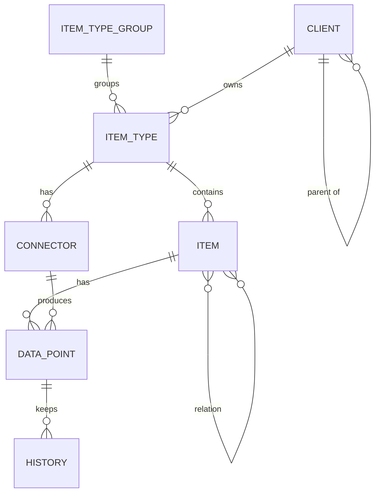

# Concepts

This page defines the terms used in the connector documentation and shows how they fit together.



## Item

An **item** is an object from the real world: a domain, a server, a hosting platform, a subscription, a customer, an
incentive. Every item belongs to one item type and one client, and is identified by a key that is natural to its type,
such as the domain name `example.com`. The platform also gives each item a numeric id and a UUID. See
[Entities and relations](entities-and-relations.md).

## Item type group and item type

An **item type** is a kind of item, such as `domain` or `server`. Item types are grouped by subject in an **item type
group**, such as `hosting` or `commercial`. Together they form the middle part of every connector path and API URL:
`hosting/domain`, `hosting/server`, `commercial/incentive`.

An item type is defined as data, in the `_entity.yaml` file of its folder, so a new kind of object needs no change to
the platform. The file names the synonyms of the key (`key-names`), the item's own `attributes` and the `relationships`
to other item types.

## Connector

A **connector** describes one data point of an item type: where the data comes from, how it is converted, what is
stored and when it is refreshed. It is a YAML file in this repository, at
`{client}/{item type group}/{item type}/{connector}.yaml`. Examples for domains are `dns`, `whois`, `certificate`,
`homepage`, `cms`, `pagespeed`, `status` and `domainvalue`.

Inside the platform a connector is stored as a **data type**; the API accepts both names (`/data-types` and
`/connectors`). The platform keeps every previous version of a connector definition when it is changed.

A connector is a small program. Its top-level keys are evaluated from top to bottom. The result of each key is stored
under its own name and can be used by every key below it. A few keys have a defined meaning, such as `type`, `include`,
`requires`, `index`, `json`, `simple-file` and `refresh`; all others are named intermediate results. Values written as
`<< expression >>` are Python expressions. The [YAML reference](language/yaml-reference.md) and the
[expression language](language/expressions.md) describe them in full.

## Data point

A **data point** is the result of one connector for one item, for example the `dns` data of `example.com`. It is
addressed by appending the connector name to the item's URL:

```text
/yourhosting/hosting/domain/example.com/dns
```

Depending on the connector, a data point consists of indexed fields that can be filtered and sorted across all items,
a JSON value, and files in object storage. The **data form** chosen with `type` decides which of these are available.
See [Storage of results](storage.md).

When a connector cannot produce its data, for example because a required value is missing, the data point holds only a
status code, such as `404` or `424`. A request for it returns that code as its HTTP status.

## Client (brand)

A **client** is a brand or tenant of the platform, such as `sitekick`, `your.online`, `yourhosting` or `argeweb`. The
documentation uses "client" and "brand" for the same thing. The client is the first part of every connector path and
every API URL.

Clients form a tree with `sitekick` at the root. A client inherits the item types and connectors of the clients above
it, and can add or override its own. Each client sees only its own items, and each token is limited to the clients it
may access.

## Include

An **include** fetches other data points of the same item before the connector continues. The `status` connector
includes `category`, `rtr`, `whois` and `dns`, and combines them into one verdict. Included data points are fetched in
parallel, and are computed first if they are missing. In expressions they are available as `include.<connector>`, for
example `include.homepage.attributes.final_url`.

A **requirement** (`requires`) stops the connector when a value is empty, and stores only a status code. Both are
described in [Includes and requires](language/includes-and-requires.md).

## Refresh

A **refresh** computes a data point again. Each connector has its own refresh rule, for example `every: ~month` (once a
month, at a random moment within the month), a cron expression, a fixed moment, `never` or `on-demand` (every time the
data is requested). The rule is evaluated like any other key, so it can depend on the data just computed. See
[Refresh rules](language/refresh.md).

A refresh starts when the scheduled moment has passed, or when someone requests data that is missing or asks for a
refresh with `refresh=now`.

## Queue

Refreshes do not run inside the request. The platform puts them on a priority queue, and workers take them from the
queue and evaluate the connector. Refreshes that a caller waits for go before background refreshes. Each
[include level](language/includes-and-requires.md#include-levels) has its own queue, so a connector that waits for its
includes never blocks the workers that compute them. A request waits a limited time
for the result, and answers `202 Accepted` if the refresh takes longer.

## History

Every data point has a **current value** and a **history**. After each refresh the new value is compared with the
current one:

- if nothing changed, only the moment of the check is recorded;
- if something changed, the previous version is closed with an end time and the new version is added.

The history therefore holds one entry per distinct value, a change-only timeline, and shows what a data point looked
like at any moment and when it changed. The `history` modifier returns it:

```text
/yourhosting/hosting/domain/example.com/dns/history
```

## Function

A **function** is reusable Python logic in the platform that connectors call from their expressions, for example
`functions.hosting.nslookup`, `functions.hosting.whois` or `functions.hosting.supercat`. Functions keep connectors
short and declarative. They are available as `functions.<package>.<name>` or, shorter, `f.<package>.<name>`, without an
import.

## Modifier

A **modifier** presents a data point in another form. Most modifiers follow the connector in the URL: `/history`,
`/public` (with the internal id replaced by the UUID), `/file/<name>` (a stored file), or a view for one application, a
backend for frontend (BFF), such as `/youradvice`:

```text
/yourhosting/hosting/domain/example.com/dns/history
```

A connector can name a default view with the `bff` keyword. See the
[recipes](recipes.md#a-connector-with-a-default-view).

`multi` and `hubspot` are **prefix modifiers**: pseudo-connectors that precede the connector name in the URL. `multi`
requests several connectors at once, `hubspot` requests one connector within a time limit:

```text
/yourhosting/hosting/domain/example.com/multi/dns,whois
/yourhosting/hosting/domain/example.com/hubspot/pagespeed
```

Both are described in [Domain connectors](catalogue/hosting-domain.md#pseudo-connectors).
