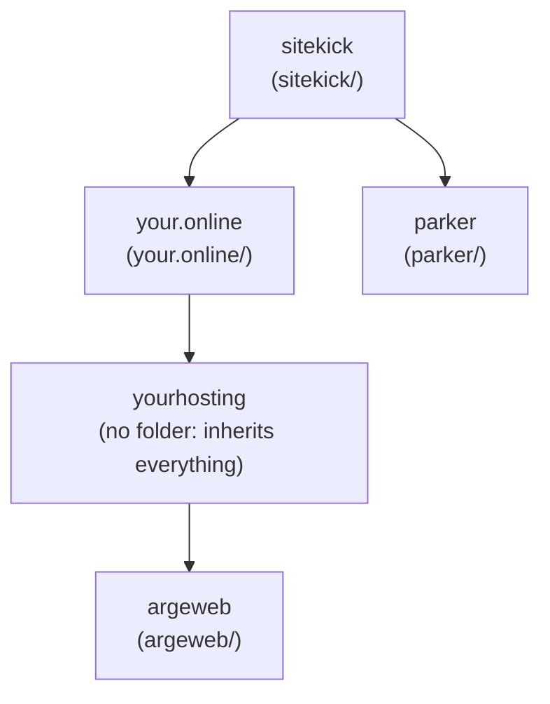

# Sitekick connectors

This repository holds the connector definitions for the Sitekick hosting intelligence platform. Sitekick collects data
about domains, websites, servers and customers, keeps the history of that data and serves it through a JSON:API-style
API. A connector defines, for one kind of data, the data source, the processing and validation rules, what is stored
and when it is refreshed.

The connectors are configuration, not code: the platform loads these YAML files and evaluates them. The functions that
connectors call, such as `functions.hosting.nslookup`, are part of the platform, not of this repository.

## What a connector is

A connector is a YAML file with embedded Python expressions. It describes one data point of an item type, for example
the `dns` data of a domain. The top-level keys are evaluated from top to bottom, and each key can use the result of the
keys above it.

```yaml
type: StrInt                       # data form: four text and four small-integer columns

dns: << functions.hosting.nslookup(params.domain, 'common') >>

requires: << dns >>                # no DNS data: store status 404 and stop

index:                             # typed fields, stored in indexed columns
    a1: << dns.generic.a1 >> -> str
    ns1: << dns.generic.ns1 >> -> str
    mx1: << dns.generic.mx1 >> -> str

simple-file:                       # the complete lookup, in object storage
    full.json: << dns >>

refresh:
    every: << '3 ~months' if not index.a1 else '1 ~month' >>
```

Placed at `sitekick/hosting/domain/dns.yaml`, this file defines the connector `dns` for domains. Its `type` selects
the [data form](storage.md#data-forms): the set of columns in which the result is stored. The domain name is available
to the expressions as [`params.domain`](language/yaml-reference.md#params). A request for
`/yourhosting/hosting/domain/example.com/dns` returns its result; `yourhosting` is the client (brand) that asks, see
[How the repository is organised](#how-the-repository-is-organised). The platform refreshes it once a month at a random
moment, or once every three months for a domain without an A record. The [concepts](concepts.md) page explains the
terms; the [YAML reference](language/yaml-reference.md) lists every keyword.

## How the repository is organised

The path of a file is the identity of the connector:

```text
{client}/{item type group}/{item type}/{connector}.yaml
sitekick/hosting/domain/dns.yaml   ->  sitekick/hosting/domain/dns
```

Each item type folder has an `_entity.yaml` that defines the item type itself: its key names, its own attributes and
its relations to other item types (see [Entities and relations](entities-and-relations.md)). Files whose name starts
with `_` are not loaded as connectors.

The top-level folders belong to clients (brands) of the platform:

| Folder | Client | Content |
|---|---|---|
| `sitekick/` | `sitekick`, the root client | Item types and connectors available to every client: `hosting/domain` (the website and domain tests), `hosting/server`, `hosting/platform`, `hosting/network`, settings, and connectors for development and testing |
| `your.online/` | `your.online` | Connectors of the Your.Online hosting group: commercial incentives and actions, contacts, hosting subscriptions, products and customers |
| `argeweb/` | `argeweb` | The Argeweb brand, with its own domain item type |
| `parker/` | `parker` | Legacy: item types for analytical devices and their measurements |

Clients form a tree, with `sitekick` at the root. When the platform looks up a connector for a client and the client
has no connector with that name, it looks at the parent client, and so on up to `sitekick`. A client therefore
inherits every connector of the clients above it. It overrides one by placing a file with the same name in its own
folder, next to its own `_entity.yaml`.



A request for `/yourhosting/hosting/domain/example.com/dns` uses `sitekick/hosting/domain/dns.yaml`, because neither
`yourhosting` nor `your.online` defines its own `dns` connector. A brand such as `yourhosting` needs no folder of its
own as long as the inherited connectors suffice.

## Using the API

Every request needs a bearer token, issued per client by the operator of the platform. The examples use
`https://api.example.com`; replace it with the address of your Sitekick installation.

```text
https://api.example.com/{client}/{item type group}/{item type}/{key}[/{connector}[/{modifier}]]
```

- **Client**: the brand, such as `yourhosting`. It determines which connectors apply and which items you see.
- **Item type group and item type**: the subject, such as `hosting/domain` or `hosting/server`. The plural form
  (`hosting/domains`) returns a list.
- **Key**: the item. Use its natural key (`example.com`), its numeric id or its UUID.
- **Connector**: the data point, such as `dns` or `timing`.
- **Modifier**: an optional view of the data point, such as `history` or `file/full.json`.

| Request | Result |
|---|---|
| `GET /yourhosting/hosting/domain/example.com` | The domain with its data points |
| `GET /yourhosting/hosting/domain/12345` | The same domain, by its numeric id |
| `GET /yourhosting/hosting/domain/<uuid>` | The same domain, by its UUID, which does not reveal the internal id |
| `GET /yourhosting/hosting/domain/example.com/timing` | The `timing` data point |
| `GET /yourhosting/hosting/domain/example.com/dns/history` | Every stored version of the `dns` data point |
| `GET /yourhosting/hosting/domain/example.com/dns/file/full.json` | A file stored by the `dns` connector |
| `GET /yourhosting/hosting/domain/example.com/timing?refresh=now` | The `timing` data point, refreshed first |

A data point that has never been computed is computed on first access. `refresh=now` forces a new computation, unless
the connector sets a minimum age with `properties.min_refresh_time`. If the computation takes longer than the platform
waits, the answer is `202 Accepted`; request the data point again to read the result. Requesting a data point of an
item that does not exist yet creates the item, if your token allows creating.

```http
GET /yourhosting/hosting/domain/example.com/dns HTTP/1.1
Host: api.example.com
Authorization: Bearer <token>
```

## Reading guide

| Section | Page | Read it for |
|---|---|---|
| Getting started | [Writing your first connector](getting-started.md) | A first connector, from file to stored data point and pull request |
| | [Recipes](recipes.md) | Short worked examples to start a new connector from |
| Concepts | [Concepts](concepts.md) | The vocabulary: items, item types, connectors, data points, clients, includes, refresh, history |
| | [Entities and relations](entities-and-relations.md) | Item types, keys, `_entity.yaml` and relations between items |
| | [Storage of results](storage.md) | Data forms, indexed fields, JSON, files and history |
| Connector language | [Connector YAML reference](language/yaml-reference.md) | Every keyword of a connector definition |
| | [Expression language](language/expressions.md) | The `<< ... >>` expressions, casts, `@suppress` and the names available in expressions |
| | [Includes and requires](language/includes-and-requires.md) | Combining connectors, and stopping when data is missing |
| | [Refresh rules](language/refresh.md) | When a data point is computed again |
| | [Secrets in connectors](secrets.md) | Encrypted API keys in connector files |
| Catalogue | [Connector catalogue](catalogue/index.md) | The connectors in this repository and their fields: [Domain connectors](catalogue/hosting-domain.md) and [Other connectors](catalogue/other.md) |

How the platform loads, validates and runs connectors in more depth, and how to install it, is described in the
Sitekick platform documentation.
