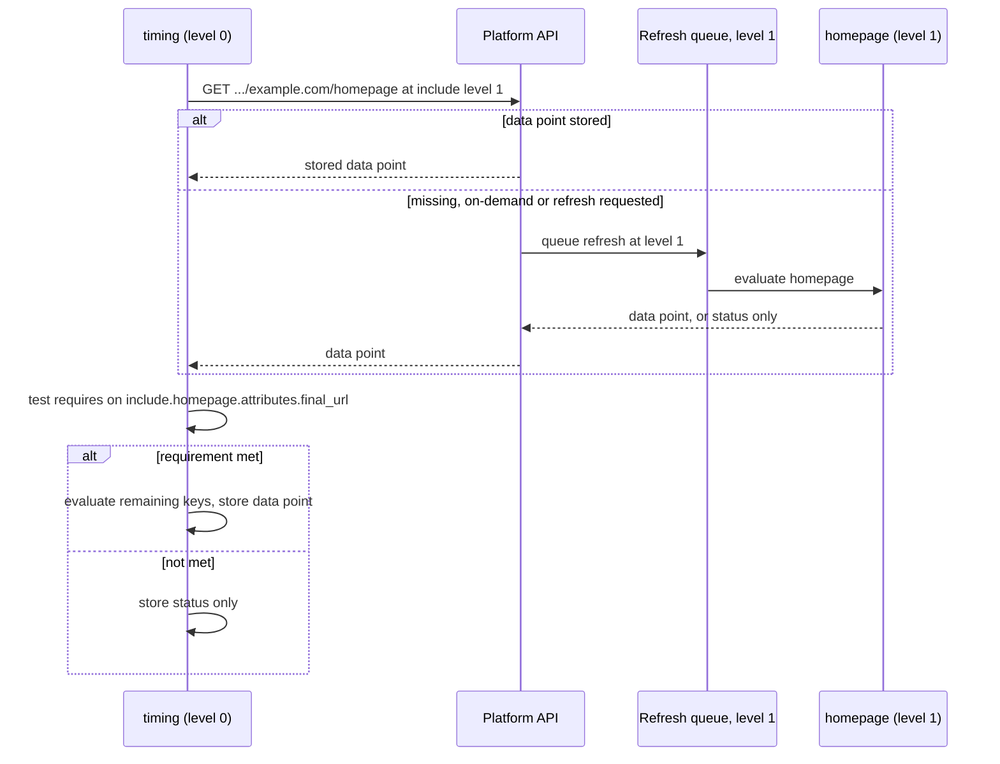

# Includes and requires

Connectors build on each other. `include` fetches the data points of other connectors for the same item, and
`requires` stops a connector when a condition is not met. Together they express dependencies such as "measure the
response time only when the domain has a homepage". The keywords are summarised in the
[Connector YAML reference](yaml-reference.md); this page describes their behaviour.

## Include

```yaml
include: homepage            # one connector
```

```yaml
include:                     # several connectors, fetched in parallel
    - category
    - rtr
    - whois
    - dns
```

The value is a connector name or a list of names of the same item type. The key is evaluated like any other, so the
connectors are fetched when the evaluation reaches it, and the result is available to every key below it.

### The result

`include.<name>` holds the included data point as the API returns it:

| Expression | Content |
|---|---|
| `include.homepage.attributes.final_url` | A field of the included data point: its `index` fields and the keys of its `json` value |
| `include.content.links.files['full.json']` | The link to a file stored by the included connector |
| `include.dns.meta.refreshed_at` | When the included data point was last refreshed |
| `include['test-req-1'].attributes.now` | Subscript notation, for connector names with a hyphen |

Files of an included connector are read with `get`, as `copyright` does:

```yaml
include: content

content_file: << include.content.links.files['full.json'] >>
requires(424): << content_file >>
content: << get(content_file).json() >>
```

If the included connector has a default modifier (`bff`), the include receives the modified form, because it requests
the data point by its plain name.

### How an include is fetched

The platform fetches an include through its own API, as a client would: it requests `<item>/<name>` for the same item,
one include level deeper than the current connector, with the current `params` as query parameters.

- **Stored or refreshed.** The included data point is returned as stored. It is refreshed first:
    - when it does not exist yet;
    - when its connector is `on-demand`;
    - when the request asks for it with `refresh=now` or `refresh=<interval>`, which is passed on to the include;
    - in a [scheduled refresh](refresh.md#scheduled-refresh), when it is a direct include (include level 1) whose last
      refresh is more than an hour ago.

    In each case the included data point is refreshed only up to the include level set by `max-refresh-level`, and not
    while the `min_refresh_time` of its connector has not passed.
- **Parameters are passed on.** The parameters of the current connector, including `refresh` and
  `max-refresh-level`, reach the included connectors. A request with `refresh=now` therefore also refreshes the
  included data points, down to the include level set by `max-refresh-level` (see [Refresh rules](refresh.md)).
  Defaults set in a `params` key above the `include` are passed on as well.
- **Waiting.** While an included data point is being refreshed, the include waits for it, with a limited number of
  retries, before the next key is evaluated.
- **Parallel.** The connectors of a list are fetched at the same time; the include completes when all have answered.

### Include levels

Every include runs one level deeper than the connector that includes it: a requested data point is evaluated at level
0, its includes at level 1, their includes at level 2, and so on. The platform keeps a separate refresh queue, with its
own workers, for each level. A refresh that waits for its includes therefore never occupies the workers that must
compute them.

The longest chain in this repository starts at `sitekick/hosting/domain/ssl`: `ssl` → `status` → `category` →
`content` → `homepage`, levels 0 to 4. The
number of levels with workers is set by the operator of the platform; keep chains short.



### When an included connector has no data

If the included connector stopped on a requirement, or its refresh failed, the include holds none of its fields:
`include.homepage.attributes.final_url` is empty. Test for that with a requirement, usually with status 424
(failed dependency):

```yaml
include: homepage

requires(424): << include.homepage.attributes.final_url >>

links: << functions.hosting.link_check(include.homepage.attributes.final_url) >>
```

Without such a test, the connector continues with empty values, which can be intended: `hosting_by_dns` combines
`whois` and `dns` without a requirement and stores whatever fields are available.

### Rules for includes

- Place `include` before the keys that read it.
- Never let a connector include itself, directly or through other connectors.
- Keep chains short: each level waits for the next.
- Place `params` after `include` when its defaults are meant for this connector only.

## Requires

```yaml
requires: << dns >>
```

The value is one expression: a condition, or a value to test. It is evaluated and tested for truth, as in a Python
`if`. `None`, empty values, `0`, `False`, `''` and empty lists or mappings fail; any other value passes. For several
conditions, use one requirement per condition with the numbered variants `requires0` … `requires9` (see
[Variants](#variants)).

### Variants

| Key | Status when not met |
|---|---|
| `requires` | 404 |
| `requires(<status>)` | The given status, for example `requires(424)` |
| `requires0` … `requires9` | 404 |
| `requires0(<status>)` … `requires9(<status>)` | The given status |

A YAML mapping cannot contain the same key twice. Use `requires`, `requires(424)` and the numbered variants for more
than one requirement; each is evaluated at its own position.

### Status codes

| Status | Meaning | Used by |
|---|---|---|
| 404 | Not found: no information available for this item | `dns`, `homepage`, `detailed_homepage`, `certificate`, `timing`, `copyright` |
| 424 | Failed dependency: data from another connector is missing | `pagespeed`, `content`, `links`, `cms`, `screenshot`, `google_analytics`, `copyright` |
| 403 | Forbidden: the data is rejected, for example pushed data that fails validation | |
| 410 | Gone: the outcome is not recorded as a refresh; no refresh moment, timestamp or history version is written | |

### What happens when a requirement is not met

1. Evaluation stops at the requirement; the keys below it are not evaluated.
2. Instead of its data, the platform stores a data point that holds only the status, in the `Empty` data form. Its
   `status` attribute is the code, and a request for the data point returns the code as its HTTP status.
3. The status stays the current value of the data point until a later refresh meets the requirement and stores data
   again.

An unmet requirement is not an error: the refresh succeeds, and it is not retried as a failed refresh would be. When
the status data point is refreshed again is described in [Refresh rules](refresh.md#status-data-points).

Files written by `file` or `simple-file` keys above the requirement remain stored. Place requirements before costly
calls and before file keys.

### Examples

A source without data, from `dns`:

```yaml
dns: << functions.hosting.nslookup(params.domain, params.dns_type, substitutions) >>

requires: << dns >>
```

Two requirements, from `copyright`, which stores a year only when one is found and it is plausible:

```yaml
match: << [group[-1] for group in regex if regex.match('.*\d{2,4}', group[-1])] >>

requires: << match >>
year1: << max(int((m.replace('-', ' ').strip()).rsplit()[-1]) for m in match) >>

year: << year1 if year1 > 1900 else year1 + 1900 if year1 > 80 else year1 + 2000 >>
requires1: << 1980 <= year <= datetime.date.today().year >>
```

A condition on two includes, from `pagespeed`, which tests only active websites:

```yaml
include:
    - homepage
    - category

requires(424): << include.homepage.attributes.final_url and include.category.attributes.category == 'active' >>
```

## Test connectors

The connectors `test-req-1`, `test-req-2` and `test-req-3` for domains show how a status travels along includes:

```yaml
# test-req-1
params:
    requires: 1

requires: << int(params.requires) >>
```

```yaml
# test-req-2
include: test-req-1

requires(424): << include['test-req-1'].attributes.now >>
```

```yaml
# test-req-3
include:
    - test-req-1
    - test-req-2

requires(424): << include['test-req-1'].attributes.now or include['test-req-2'].attributes.now >>
```

A request for `.../example.com/test-req-2?requires=0&refresh=now` passes `requires=0` on to `test-req-1`, which stops
with 404. `test-req-2` then finds none of the fields of `test-req-1` in its include and stores 424. A request for
`test-req-3` with the same parameters stores 424 for the same reason. The connectors `a`, `b` and `c` in `sitekick/dev/require` show the same pattern with a numeric condition,
such as `requires: << include.a.attributes.a1 >= 1 >>`.
